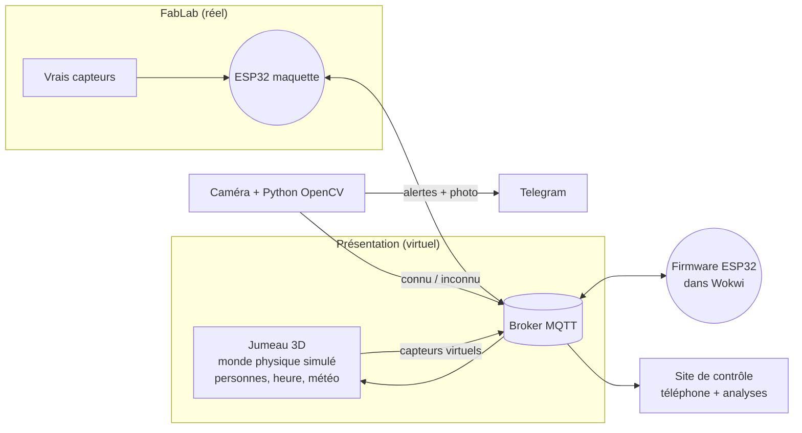

# Maison intelligente IoT : jumeau numérique 3D + maquette FabLab

Projet de maison connectée conçu **d'abord en virtuel**, puis réalisé au **FabLab**, avec **le même code, le même plan et les mêmes outils**.

| Problème | Solution | Composants |
|---|---|---|
| **Confort** | Lumière selon la présence et la lumière du jour ; ventilateur et chauffage automatiques | Radar mmWave HLK-LD2410, photorésistance (LDR), DHT22, relais + ventilateur, LED rouge « chauffage » |
| **Sécurité** | Reconnaissance des visages, détection d'intrusion, alerte immédiate | Caméra + PC (Python / OpenCV), contact de porte (ILS), MQ-2 (gaz), sirène, bot Telegram |
| **Économie** | Énergie solaire indépendante, mode éco, économie mesurée | Mini panneau solaire, batterie 18650, TP4056, INA219 |
| **Pilotage** | Contrôle et analyses en temps réel | Site de contrôle (téléphone), écran OLED, bouton |

## Le principe : un seul code pour le virtuel et le réel

- **Le jumeau 3D joue le rôle du monde physique** : il calcule la température de la pièce, la lumière du jour, l'énergie solaire et la position des personnes, puis il envoie ces valeurs comme des **capteurs virtuels**.
- **Le firmware ESP32 est le cerveau** : c'est le même fichier `.ino` dans Wokwi et sur la maquette. Une seule commande MQTT (`cmd/source`) choisit si ses capteurs sont virtuels (jumeau 3D) ou réels (broches).
- **La vision par ordinateur est la même** : `vision/surveillance.py` analyse la webcam du PC pendant la présentation, puis la caméra de la maquette au FabLab.
- **Le plan est le même** : `plan/plan.js` décrit les murs, les pièces et l'emplacement de chaque composant. La 3D le lit, et `plan/generer_plans.py` en tire les fichiers de découpe laser et le plan de câblage.

## Contenu du dépôt

| Dossier | Contenu |
|---|---|
| [`plan/`](plan/) | Plan unique de la maison + plans de fabrication générés (découpe laser 1/20, câblage) |
| [`firmware/`](firmware/) | Firmware ESP32 (Arduino) + circuit **Wokwi** |
| [`jumeau-3d/`](jumeau-3d/) | Jumeau numérique : la maison grandeur nature, 19 composants IoT cliquables, câblage animé, caméra avec vision IA |
| [`maquette-3d/`](maquette-3d/) | La maquette FabLab en carton au 1/20, avec les vrais modules à leur taille réelle et les fils Dupont |
| [`site-controle/`](site-controle/) | Site de pilotage responsive (ordinateur et téléphone) : alarme avec code et SOS, lumières, climat, énergie, caméra en direct, analyses |
| [`presentation/`](presentation/) | Présentation de 26 diapositives, avec la photo et le fonctionnement de chaque composant, et les notes de l'orateur |
| [`vision/`](vision/) | Reconnaissance faciale OpenCV (YuNet + SFace), flux vidéo annoté, alertes Telegram |
| [`web/`](web/) | Code commun aux pages web (connexion MQTT, émulation hors ligne) |
| [`docs/`](docs/) | [Mise en ligne et travail à deux](docs/deploiement.md), [guide de présentation](docs/guide-presentation.md), [messages MQTT](docs/mqtt.md), [matériel](docs/materiel.md), [RGPD](docs/rgpd.md) |

## Les trois modes du jumeau 3D

| Mode | Qui décide ? | Usage |
|---|---|---|
| **Simulation · firmware ESP32** | Le vrai firmware dans **Wokwi** | Présentation officielle : prouve que le code fonctionne |
| **Miroir de la maquette FabLab** | Le firmware sur la **vraie carte** | Après le FabLab : la 3D reproduit la maquette en temps réel |
| **Hors ligne (secours)** | Traduction JavaScript du firmware | Uniquement si Internet manque le jour J |

## Démarrage

1. **Mettre les pages en ligne** : GitHub → *Settings* → *Pages* → *Deploy from branch* → `main` / racine. Le projet sera accessible partout sur `https://elnovic.github.io/MAISON-INTELLIGENTE-3D/` (voir [docs/deploiement.md](docs/deploiement.md)).
   Ou, en local sous Windows : double-cliquez sur `lancer-site-local.bat`.
2. **Lancer le firmware dans Wokwi** : suivez [`firmware/README.md`](firmware/README.md).
3. **Ouvrir le jumeau 3D**, choisir *Simulation · firmware ESP32*. La pastille passe à « Firmware ESP32 · capteurs 3D ».
4. **Ouvrir le site de contrôle** (bouton dans le jumeau), sur un ordinateur ou un téléphone.
5. **Caméra IA** : dans `vision/`, double-cliquez sur `1-installer.bat`, `2-chercher-camera.bat`, `3-enregistrer-resident.bat`, puis `4-lancer-surveillance.bat` (voir [`vision/README.md`](vision/README.md)). Webcam USB, ESP32-CAM ou téléphone.

> L'identifiant `maison-ia-elnovic` doit être le même dans `config.h`, `vision/config.ini`, le jumeau 3D et le site.

## Scénario de présentation (bouton dans le jumeau 3D)

1. 19 h 30 : la maison est vide et l'alarme armée. Visite du cerveau (ESP32) et des capteurs.
2. Marie rentre. La caméra la reconnaît et l'alarme se désarme.
3. Le radar détecte sa présence et il fait nuit : la lumière s'allume. Il fait 29 °C : le relais fait démarrer le ventilateur.
4. Elle passe dans la chambre. La lumière du séjour s'éteint 10 s après son départ.
5. Elle sort et arme l'alarme depuis le site. Le bilan énergétique s'affiche.
6. Un inconnu se présente : sirène, gyrophare et notification Telegram.

## Feuille de route

- [x] Plan unique + plans de fabrication
- [x] Firmware ESP32 (capteurs réels ou virtuels) + circuit Wokwi
- [x] Jumeau 3D avec composants IoT, câblage, caméra et vision
- [x] Site de contrôle et analyses en temps réel
- [x] Vision par ordinateur + Telegram
- [x] Maquette carton en 3D, présentation, déploiement en ligne
- [ ] FabLab : découpe laser, câblage, remplacement des potentiomètres par le vrai INA219 et le vrai MQ-2
